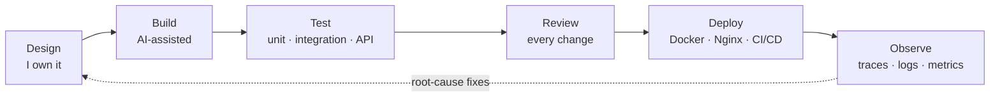

<h1 align="center">Hi, I'm Bikash Prasad Barnwal 👋</h1>

  

  
  
  
  
  

---

## 🧭 About

I'm a **Full Stack Software Engineer** at **JMV LPS Ltd.** I design, build, test, deploy and maintain web apps on my own, from the first schema to the production server.

- 🏗️ **Frontend:** React, Next.js, TypeScript, Tailwind CSS
- ⚙️ **Backend:** FastAPI, Node.js, PostgreSQL, Redis, Kafka
- 🚢 **Ship and run it:** Docker, Nginx, CI/CD on Ubuntu, with tracing, logs and metrics built in
- 🤖 **AI:** I use AI to code faster, but I design the systems myself and never hand decisions to it
- 🔐 **Security:** SSO (OIDC), role-based access control (RBAC), secret management

| | |
|---|---|
| ⏱️ **Experience** | 1+ year professional (since Oct 2025), 2160+ hours of hands-on coding |
| 🏭 **In production** | 10+ services deployed and maintained on Ubuntu servers |
| 📦 **Largest build** | Asset system tracking 1,500+ physical assets |
| 🤝 **Open source** | Merged PRs in Apache Superset and OpenWind |
| 🌍 **Based in** | India |

---

## 🚀 What I've Built (at JMV LPS)

| Project | What it does | Stack |
|---|---|---|
| **Asset Management System** | Maintenance for 1,500+ physical assets: QR-based tracking, custody records, analytics, PDF reports. OpenTelemetry traces errors and slow requests back to their source. | React · FastAPI · PostgreSQL |
| **Multi-tenant Notification Platform** | Sends messages for multiple tenants with delivery-status webhooks. Prometheus and Grafana dashboards surface failed or stuck messages early. | FastAPI · Kafka · Redis · PostgreSQL |
| **Self-hosted AI Service** | Open-source LLMs (Gemma 4, Qwen3) running on company servers. In-house apps call them over REST at zero per-call cost. Health and response times are tracked in real time. | Ollama · REST APIs |
| **WhatsApp Cloud API** | Taken from approval to production: Meta Business verification, App Review (legal, consent, privacy), then integration into company apps. | WhatsApp Cloud API · Meta Business |
| **SSO + RBAC** | Single sign-on and role-based access across internal applications. | Zitadel · OIDC |
| **Company Websites** | SEO-optimized, responsive sites deployed with Docker and Nginx. | Docker · Nginx |

---

## 🤝 Open Source: Merged Pull Requests

### [Apache Superset](https://github.com/apache/superset)

| PR | What I fixed |
|---|---|
| [#43192](https://github.com/apache/superset/pull/43192) | **fix(echarts): emit no cross-filter for clicks that are not categories.** Clicking a pie chart's Total text, its aggregated "Other" slice, or an unnamed sector sent a cross-filter with no dimension values, so downstream charts filtered on nothing. The fix emits no cross-filter for those clicks. |

### [OpenWind](https://github.com/TinyPhi/OpenWind) (open-source, self-hostable business platform, TypeScript)

**🔐 Secrets management with OpenBao (ADR-023)**

| PR | What it does |
|---|---|
| [#912](https://github.com/TinyPhi/OpenWind/pull/912) | Proposed ADR-023: OpenBao as the secrets manager |
| [#935](https://github.com/TinyPhi/OpenWind/pull/935) | Hardened the OpenBao client: request timeout, retry with backoff, token renewal, re-login on 403, shared login across concurrent callers; added production guards |
| [#936](https://github.com/TinyPhi/OpenWind/pull/936) | Kept bootstrap secrets out of `.env.local` in production |
| [#938](https://github.com/TinyPhi/OpenWind/pull/938) | Added OpenBao startup loaders and prepared the compose setup |
| [#939](https://github.com/TinyPhi/OpenWind/pull/939) | Production compose override: per-service credential files with mode 0600 |
| [#940](https://github.com/TinyPhi/OpenWind/pull/940) | OpenBao secrets runbook and production notes |

**🛡️ Superset security and audit (reporting integration)**

| PR | What it does |
|---|---|
| [#790](https://github.com/TinyPhi/OpenWind/pull/790) | Superset now refuses to start if database connections could be pooled across tenants (NullPool guard, with tests) |
| [#1069](https://github.com/TinyPhi/OpenWind/pull/1069) | Docs: recorded Superset secrets in OpenBao |
| [#1070](https://github.com/TinyPhi/OpenWind/pull/1070) | Bounded the export SQL lookup and added the database name to audit rows |

**🧹 User data erasure**

| PR | What it does |
|---|---|
| [#1100](https://github.com/TinyPhi/OpenWind/pull/1100) | Worker erases a user's Superset data automatically and retries until done |
| [#1101](https://github.com/TinyPhi/OpenWind/pull/1101) | Admin UI: erase a user from the users page with a typed confirmation |

---

## 🔁 How I Ship

- **Observability:** OpenTelemetry tracing, Loki centralized logging, Tempo distributed tracing, Prometheus metrics, Grafana dashboards
- **Quality:** I write unit, integration and API tests, and review every change before release
- **Decisions:** AI speeds up the typing. Architecture and production calls stay with me.

---

## 🛠️ Tech Stack

**Languages:**

**Frontend:**

**Backend:**

**Data and messaging:**

**DevOps and observability:**

**AI / LLM:**

Also: RAG pipelines, vector databases, Zitadel, OpenBao, Apache Superset, Shopify Liquid, Cloudinary, Vercel, Render, Netlify

---

## 💼 Experience

**Full Stack Software Engineer · JMV LPS Ltd.** (Mar 2026 – Present)
Asset Management System, notification platform, self-hosted AI service, WhatsApp Cloud API, SSO and RBAC, company websites, and 10+ production services with centralized logging and tracing.

**Software Engineer · Codem Inc., Chennai** (Oct 2025 – Mar 2026)
Built secure backend endpoints and authentication workflows. Built reusable Shopify Liquid sections and snippets, and refactored theme components for maintainability and page performance.

---

## 🔥 Personal Projects

### [CropConnect](https://crop-connect-zeta.vercel.app/) (MERN)
A real-time marketplace that connects buyers and vendors with farmers.

- 🔐 JWT authentication, password reset via email, role-based access for Farmers and Buyers
- 📬 Email alerts via NodeMailer
- 🌤️ Live weather updates from real-time APIs
- 🌽 Crop listings with images, descriptions and pricing, plus filtering and sorting by name, price and category
- ⏱️ Rate limiter: max 25 requests per 15 minutes
- 🤳 Profile images with Multer + Cloudinary

### [OKR Tracker](https://okr-trackerxvte.onrender.com)
A team goal tool for setting OKRs and tracking progress across a team.

---
## 📊 GitHub Stats

  <picture>
    <source media="(prefers-color-scheme: dark)" srcset="https://raw.githubusercontent.com/bikash-barnwal/bikash-barnwal/output/github-contribution-grid-snake-dark.svg">
    <source media="(prefers-color-scheme: light)" srcset="https://raw.githubusercontent.com/bikash-barnwal/bikash-barnwal/output/github-contribution-grid-snake.svg">
    
  </picture>

---

## 🎓 Learning

- PG Certificate in Cyber Security, IGNOU (pursuing)
- Full Stack Web Development, Masai School (2024 – 2025)
- B.Sc. Mathematics (Honours), TDB College (2020 – 2024)
- Currently going deeper into LLM hosting, RAG systems and production observability
- 🧩 50 days of LeetCode completed

---

<b>Let's build something extraordinary together.</b>

